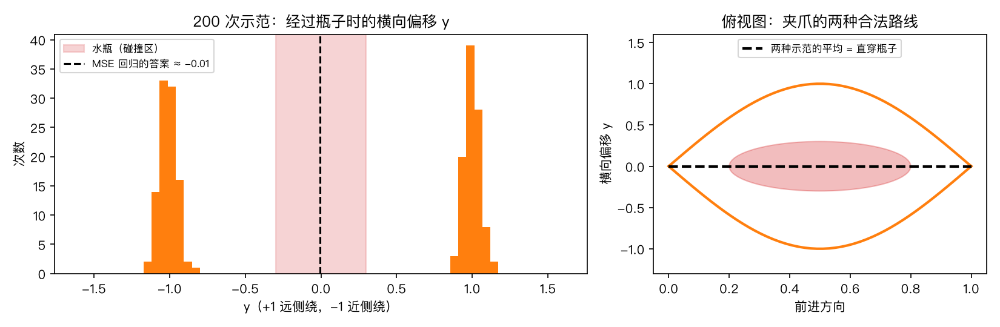
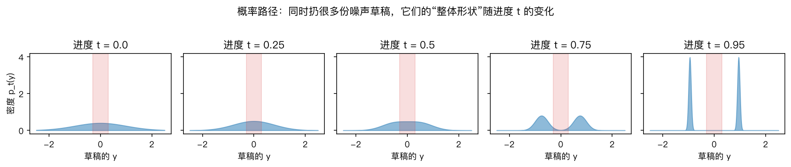
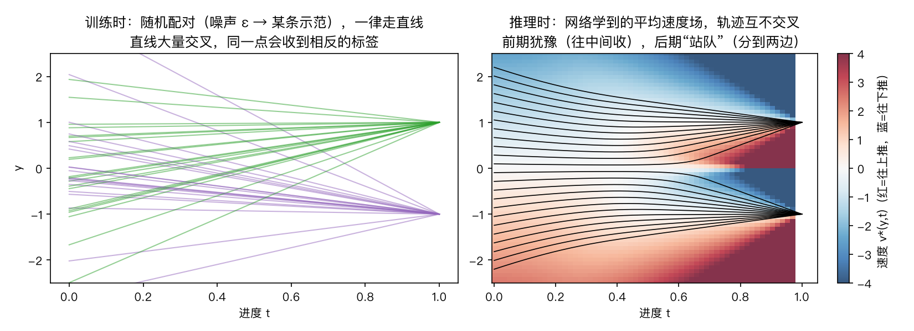
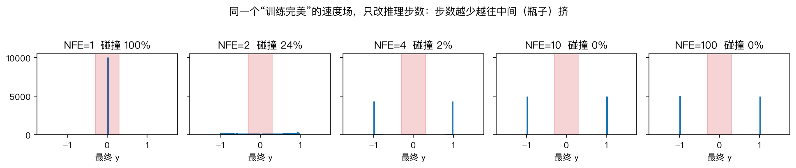

# 01. Flow Matching 核心概念（机器人版）

> 2026-10-13 重写：原来的概念讲解全部保留，每个概念都配上**同一个机器人例子**和能手算的数字。  
> 文中的数字都由 `code/robot_1d_intuition.py` 算出，图在 `figures/` 目录下。跑一遍脚本就能复现，不用训练任何网络。  
> 记号约定（全包统一）：$t=0$ 是噪声，$t=1$ 是干净动作。

---

## 0. 贯穿全包的例子：绕开水瓶去拿杯子

**场景。** 桌面机械臂要把夹爪从桌子左边移到右边的杯子那里，路正中间放着一瓶水。人类示范了 200 次：

- 大约一半从瓶子**远侧**绕过去，经过瓶子时夹爪横向偏移约 +10cm；
- 另一半从**近侧**绕过去，偏移约 −10cm；
- 两种做法都对，示范的人没有偏好。

先把问题缩到最小：**只看一个数**。

> $y$ = 夹爪经过瓶子那一刻的横向偏移，按 10cm 归一化。  
> 示范里 $y\approx+1$（远侧）或 $y\approx-1$（近侧）。$|y|<0.3$ 就会碰到瓶子。

### 0.1「数据分布」到底指什么

原文写的是「我们只有数据样本 $x_1\sim q$，却不知道数据密度 $q(x)$」。放进这个例子里就很具体了：

| 抽象说法           | 在这个例子里                                      |
| -------------- | ------------------------------------------- |
| 数据样本 $x_1$     | 某一次示范里的 $y$，比如 $+1.03$                      |
| 数据分布 $q$       | 把 200 次示范的 $y$ 画成直方图，就是上图左边那**两根尖峰**        |
| 「不知道 $q$ 的解析式」 | 我们手里只有 200 个数，没有一个公式能告诉我们「$y=0.7$ 的概率密度是多少」 |
| 从 $q$ 采样       | 生成一个新的 $y$，看起来**像是人会做的那种**：要么 ≈+1，要么 ≈−1    |

所以「数据分布」不是一个数据集文件，而&#x662F;**「在这个场景下，专家会怎么做」的统计规律**。这里的规律是：一半远侧，一半近侧，从不穿过中间。

### 0.2 再升两级维度：真实的策略长什么样

| 级别               | 生成的东西                | 维度     | 数据分布的样子                    |
| ---------------- | -------------------- | ------ | -------------------------- |
| 玩具               | 经过瓶子时的偏移 $y$         | 1      | 两根尖峰                       |
| 单步动作             | 夹爪下一步的位移 $(dx,dy)$   | 2      | 平面上两团点                     |
| **action chunk** | 未来 16 个路点，每个 $(x,y)$ | **32** | 32 维空间里的两团点。**每个点就是一整条轨迹** |
| 真实 VLA（π0）       | 未来 50 步的关节指令         | 50×关节数 | 同理，只是维度更高                  |

还有一点：真实策略面对的场景每次都不一样，瓶子的位置、杯子的位置都会变。所以我们要的其实是**条件分布** $q(A\mid o)$：**给定当前的观测 $o$**（相机图像、语言指令、关节角），专家会做出的动作的分布。换一个观测，就是另一个分布。为了把概念讲清楚，下面先固定一个场景，只看 $q(y)$；第 8 节再把 $o$ 加回来。

### 0.3 为什么不能直接用回归（这是用生成模型的根本原因）

最朴素的做法是训练一个网络 $f(o)\to y$，用均方误差（MSE）去拟合示范。

MSE 的最优解是**平均值**。200 次示范的平均值约等于 $0$，也就是**正对瓶子撞上去**（上图里的黑虚线）。

两种做法都对，它们的平均却是错的。这就是**多模态（multimodal）**&#x95EE;题，也是 Diffusion Policy、π0 这类工作要用生成模型的根本原因。我们需要的不是一个「给出唯一答案」的网络，而是一个「**能从 $q$ 里抽样**」的模型：每次抽出来的要么是远侧，要么是近侧，并且两边各占一半。

---

## 1. Flow Matching 怎么做到「抽样」

FM 的思路：**先随便猜一个，再一点点改成像样的。**

1. **先瞎猜。** 从标准高斯 $\mathcal N(0,1)$ 里抽一个数当「草稿」，比如 $y=+0.3$。这叫**源分布** $p_0$。用高斯是因为它好抽，而且什么值都可能出现。
2. **再反复修改。** 有一个网络 $v_\theta(y,t)$，每次告诉你「草稿在当前进度 $t$ 下应该往哪边改、改多快」。按它的指示一点点挪：

$$
\frac{dy}{dt}=v_\theta(y,t),\qquad t:0\to1 .
$$

1. **改完交卷。** 到 $t=1$ 时，草稿就变成了一个「像示范」的动作。

**⚠️ 第一个必须分清的东西：这里的 $t$ 不是机器人的时间。**

- **flow 时间 $t$**（也有论文写成 $\tau$）是「这份草稿改到第几成了」。它只发生在**一次推理的内部**，从 0 走到 1，可能只花 10 毫秒。这期间机器人一动不动。
- **机器人时间**是夹爪在桌上真实移动的时间。

整个 flow 跑完，我们才得到一个动作（或一整条轨迹），然后机器人才开始执行。`04` 第 6 节讲的 Streaming Flow Policy 是唯一把两者合起来的例外。

---

## 2. 四个最容易混淆的对象（都放进例子里）

### 2.1 样本轨迹 $y_t$：一份草稿被修改的过程

固定一个初始草稿，比如 $y_0=+0.3$，按速度场一路改下去，记下它在每个进度 $t$ 的值，就得到一条曲线。

它描述的是「这一次推理里，草稿从 $0.3$ 变成 $+1$ 的过程」，**不是夹爪在桌上走的路线**。

### 2.2 Flow map $\psi_t$：「扔进去一个噪声，最后会出来哪个动作」

$$
y_t=\psi_t(y_0),\qquad \dot\psi_t(y)=v_t(\psi_t(y)),\quad \psi_0(y)=y.
$$

在例子里，$\psi_1$ 可以理解成一张**查找表**：$\psi_1(+0.3)=+1$（远侧），$\psi_1(-0.8)=-1$（近侧）。flow map 是「整个变换」，速度场是这个变换在每一刻的瞬时导数。

> 后面会看到，少步方法（Consistency、Shortcut、MeanFlow）本质上就是**直接去学这张查找表**，而不是学速度场。

### 2.3 概率路径 $p_t$：很多份草稿「整体」的形状

如果同时扔 1000 份噪声草稿，在进度 $t$ 那一刻把它们的值画成直方图，这个形状就是 $p_t$：

$$
y_t=\psi_t(y_0),\quad y_0\sim p_0\ \Longrightarrow\ y_t\sim p_t .
$$

- $t=0$：一团普通的高斯（随机草稿）；
- $t=0.5$：还是一团，只是变宽变扁了；
- $t=0.75$：开始分成两个包；
- $t\to1$：变成 ±1 两根尖峰，也就是示范的分布。

**样本轨迹是一条线（一份草稿的经历）；概率路径是一族分布（所有草稿在每个时刻的整体形状）。** 二者不是同一个东西。

### 2.4 速度场 $u_t(y)$：网络本身

速度场回答的问题是：**「在进度 $t$、草稿当前值为 $y$ 的时候，该往哪边改、改多快？」**

在真实机器人里，它就是那个 action expert 网络：

- 输入：当前草稿（整个 action chunk）、进度 $t$、观测 $o$；
- 输出：和 chunk 同形状的一个张量，表示每个数该怎么改。

在这个 1D 例子里，「训练到完美」的速度场可以精确算出来（推导见 `02_formula_derivations.md` 第 5.5 节）：

右图的颜色就是速度：红色往上推，蓝色往下推。黑线是一份份草稿实际走过的样本轨迹。注意两件事：

1. **前期（$t<0.4$）**&#x51E0;乎全是「往中间收」。这时网络还判断不出草稿该去哪边，只能先往两边的平均值靠。
2. **后期**才开始「站队」：在中线以上的被推向 +1，在中线以下的被推向 −1。

若速度场推动草稿的整体分布恰好沿着 $p_t$ 演化，就称 $u_t$ **生成**了 $p_t$。

---

## 3. 连续性方程：草稿不会凭空出现或消失

速度场和概率路径必须满足：

$$
\partial_t p_t(y)+\nabla\cdot\big(p_t(y)u_t(y)\big)=0.
$$

**白话**：草稿只会被「推着走」，不会凭空多出来或少掉。任何一小段区间里草稿数量的变化，都等于从两边流进来的减去流出去的。这和流体力学的质量守恒完全同构。

**放到例子里**：开局 1000 份草稿，结束时还是 1000 份。所以最后落在远侧的比例，就等于一开始被推向远侧的那些草稿的比例。实测（`robot_1d_intuition.py` 表 4）：10000 份噪声，用完美速度场积分，**49.7% 去了远侧**，和示范的 50% 一致。

**这就是 FM 能复现示范里「各种做法的比例」的原因**：它不是在挑一个最好的答案，而是在搬运整个分布。

沿着一条草稿轨迹，密度还满足：

$$
\frac{d}{dt}\log p_t(y_t)=-\nabla\cdot u_t(y_t).
$$

这让 CNF 可以算出「生成这个动作的概率」$\log p(A\mid o)$。但计算散度、以及在训练里解 ODE 都很贵。FM 的价值之一，就是**训练时不需要解 ODE**。

> **机器人里什么时候需要 $\log p$？** 用强化学习（PPO 等）微调一个 flow policy 的时候。所以「flow policy 的似然难算」是 RL 微调的核心难点，见 `04` 第 11 节。

---

## 4. Flow Matching 的理想目标

假设我们**已经知道**那个完美的速度场 $u_t$，直接回归就好：

$$
\mathcal L_{\mathrm{FM}}(\theta)
=\mathbb E_{t\sim U[0,1],\,y\sim p_t}
\left[\|v_\theta(y,t)-u_t(y)\|_2^2\right].
$$

**问题是我们并不知道 $u_t$。** 看第 2.4 节那张图就知道为什么：要算出「草稿在 $y=0.2$、$t=0.5$ 时该往哪推」，你得同时知道所有示范，知道一半在 +1、一半在 −1，然后综合判断。

1D 的时候还能写出公式；到了真实的 32 维 action chunk、上万条示范、每个观测都不一样的情况，**完美速度场根本写不出来**。

---

## 5. CFM 的关键转折：每次只看一条示范

既然没法同时考虑所有示范，那就**每次只拿一条**。

**训练时的一步（以例子为准）：**

1. 随机拿一条示范，比如 $y_1=+1$（远侧）；
2. 随机抽一份噪声草稿，比如 $\varepsilon=-0.4$；
3. 随机抽一个进度，比如 $t=0.3$；
4. 在两者之间按比例取一个中间点：$y_t=(1-t)\varepsilon+t\,y_1=0.7\times(-0.4)+0.3\times1=0.02$；
5. 告诉网络：「在 $(y=0.02,\ t=0.3)$ 这里，应该往 $y_1-\varepsilon=1.4$ 的方向走。」

这里用到的路径叫**条件路径**（conditioned on 这一条示范），它的速度 $u_t(y\mid y_1)$ 叫**条件速度**，计算非常简单。

**问题来了：同一个点会收到相反的标签。**

下一次可能抽到 $y_1=-1$（近侧）、$\varepsilon=+0.6$、$t=0.3$，算出来的中间点 $y_t=0.7\times0.6+0.3\times(-1)=0.12$，离刚才那个点很近，标签却是 $-1.6$，方向**正好相反**。第 2.4 节图左边那些交叉的直线，画的就是这种情况。

**为什么网络还是能学对？** 平方损失面对「同一个输入、不同的标签」时，最优解是**标签的加权平均**，权重是「这个点更可能来自哪条示范」。这个加权平均正好等于第 4 节那个写不出来的完美速度场：

$$
u_t(y)=\mathbb E\left[u_t(y_t\mid y_1)\mid y_t=y\right].
$$

于是我们可以训练一个**算得出来的目标**：

$$
\mathcal L_{\mathrm{CFM}}(\theta)
=\mathbb E_{t,\,y_1,\,y\sim p_t(\cdot\mid y_1)}
\left[\|v_\theta(y,t)-u_t(y\mid y_1)\|_2^2\right].
$$

更严格地说，FM 和 CFM 两个目标只相差一个与参数无关的常数，所以**梯度完全相同**。完整推导见 `02` 第 6 节。

**用数字看「加权平均」**（`robot_1d_intuition.py` 表 1）：

| 进度 $t$ | 草稿 $y$ | 网络判断「它该去远侧」的概率 | 加权平均的目标 $\mathbb E[y_1\mid y]$ |         速度 $v^*$ |
| -----: | -----: | -------------: | -----------------------------: | ---------------: |
|    0.1 |    0.5 |            53% |                           0.06 |      −0.49（往中间收） |
|    0.3 |    0.5 |            65% |                           0.30 |    −0.29（还在往中间收） |
|    0.5 |    0.2 |            69% |                           0.38 |    +0.36（开始往远侧推） |
|    0.5 |    0.5 |            88% |                           0.76 |            +0.52 |
|    0.7 |    0.2 |            96% |                           0.92 |      +2.38（加速站队） |
|    0.9 |    0.2 |           100% |                           1.00 | +8.00（必须马上赶到 +1） |

读这张表就能明白，为什么第 2.4 节的图里前期往中间收、后期站队：

- **早期**，草稿离 $\pm1$ 都很远，很难判断它来自哪条示范，所以加权平均接近 $0$，速度指向中间；
- **后期**，草稿已经明显偏向一边，判断几乎确定，速度就指向那一侧的示范。

---

## 6. 最常用的线性条件路径

第 5 节用的「按比例取中间点」就是线性路径：

$$
y_t=(1-t)\,\varepsilon+t\,y_1 .
$$

对 $t$ 求导，条件速度是一个**常数**：

$$
\dot y_t=y_1-\varepsilon .
$$

**所以训练循环只有五行**（对应机器人代码）：

| 步骤     | 1D 例子                            | 真实 action chunk                                |
| ------ | -------------------------------- | ---------------------------------------------- |
| 1. 采数据 | 从示范里拿一个 $y_1$                    | 从数据集拿一个 $A\in\mathbb R^{16\times2}$ 和对应的观测 $o$ |
| 2. 采噪声 | $\varepsilon\sim\mathcal N(0,1)$ | `torch.randn_like(A)`                          |
| 3. 采进度 | $t\sim U[0,1]$                   | 每个样本一个 $t$（π0 用 beta 分布，偏向噪声大的一端）              |
| 4. 插值  | $y_t=(1-t)\varepsilon+t\,y_1$    | `A_t = (1-t)*eps + t*A`                        |
| 5. 回归  | MSE，拟合 $y_1-\varepsilon$         | `loss = mse(net(A_t, t, o), A - eps)`          |

训练过程中没有 ODE 积分，也不需要对 ODE 求解器反向传播。这就是 **simulation-free training** 的含义。

> **⚠️ 机器人领域的人特别容易误会**：这里的 simulation 指的是「数值模拟 ODE」，**不是物理仿真器**。simulation-free 的意思是训练时不用解 ODE，和「需不需要 MuJoCo / Isaac 仿真环境」没有任何关系。另外，**推理时仍然要解 ODE。**

---

## 7. 训练与采样的最小闭环

### 训练

$$
\boxed{
\mathcal L(\theta)=
\mathbb E\left[
\|v_\theta((1-t)\varepsilon+t\,y_1,\ t)-(y_1-\varepsilon)\|^2
\right]
}
$$

### 采样（推理）

抽一份新的噪声草稿 $y(0)\sim\mathcal N(0,1)$，然后反复执行：

$$
y(t+\Delta t)=y(t)+\Delta t\;v_\theta(y(t),t)
$$

直到 $t=1$。这叫 **Euler 法**，是最简单的一阶方法。Heun / midpoint 每一步多调用一次网络，换取更小的误差。

**手算一遍：噪声 $\varepsilon=+0.3$，Euler 走 2 步**（`robot_1d_intuition.py` 表 3）：

| 步 |    当前进度 |     当前草稿 |           网络的目标估计 |       速度 |        走半步之后 |
| - | ------: | -------: | ----------------: | -------: | -----------: |
| 1 |   $t=0$ | $+0.300$ | $0.000$（完全不知道去哪边） | $-0.300$ |     $+0.150$ |
| 2 | $t=0.5$ | $+0.150$ |    $+0.291$（略偏远侧） | $+0.283$ | **$+0.291$** |

两步走完，最终 $y=0.29$。**它停在了瓶子边上**（$|y|<0.3$ 即碰撞）。同一份噪声换成不同步数（表 2）：

| 步数（NFE） |     1 |     2 |     3 |     4 |     6 |    10 |
| ------- | ----: | ----: | ----: | ----: | ----: | ----: |
| 最终 $y$  | 0.000 | 0.291 | 0.781 | 0.997 | 1.000 | 1.000 |

**NFE（Number of Function Evaluations）** 就是「网络被调用了几次」。π0 用的是 10 步 Euler，也就是 10 次调用。推理延迟大约和 NFE 成正比。

---

## 8. 多模态从哪里来？

ODE 本身是**确定性**的：给定初始草稿，结果就唯一确定了。那「有时远侧、有时近侧」是从哪里来的？

**答案：全部来自初始噪声。** 实测（表 5）：积分 200 步之后，**最终的绕行方向和初始噪声的正负号 100% 一致**。噪声是正的就去远侧，是负的就去近侧。噪声一半正一半负，所以两种绕法各占一半。

所以「确定性 ODE 不等于只能输出一种动作」：**随机性在起点，确定性在过程。**

### 把观测加回来：条件生成

真实策略要看观测 $o$，网络就多读一个输入：

$$
\dot y_t=v_\theta(y_t,t,o).
$$

固定 $o$，多换几次噪声，就会得到多个合法动作。$o$ 一变（比如瓶子挪到了左边），整个速度场也跟着变，生成的动作也就不同。

### 一个实际的坑：chunk 之间会「换边」

机器人每执行完一个 chunk，就重新看一次、重新抽一次噪声。上一个 chunk 抽到了正噪声（远侧），下一个可能抽到负噪声（近侧），夹爪就会**在两种绕法之间来回摇摆**。这叫 mode jumping。RTC 这类「实时分块执行」方法要解决的就是它，见 `04` 第 11 节。

---

## 9. 为什么少步会撞瓶子（本节最重要）

第 7 节的表已经看到：**只走 1 步，结果正好是 0**，正对瓶子。这不是巧合，可以直接算出来：

在 $t=0$ 时，草稿就是纯噪声，和它最终要去哪条示范**毫无关系**。所以网络能给出的最好估计只能是「所有示范的平均」：

$$
v^*(y,0)=\mathbb E[y_1]-y=0-y
\quad\Longrightarrow\quad
y+1\cdot v^*(y,0)=0 .
$$

**1 步 Euler 会把每一份噪声都送到示范的平均值上，也就是第 0.3 节里 MSE 回归给出的那个撞瓶答案。** 少步生成退化成了回归。

即使速度场是**完美**的，只改变步数，结果也是（表 4，10000 份噪声）：

| NFE |        1 |     2 |    3 |    4 |    6 |   10 |
| --- | -------: | ----: | ---: | ---: | ---: | ---: |
| 碰撞率 | **100%** | 24.0% | 6.4% | 1.9% | 0.2% | 0.0% |

这张表说明：**少步的失败不全是「网络没训好」，有一部分是「积分走得太粗」。** 这两种误差是不同的来源，做实验时要分开看。

真实网络（不是完美速度场）在 32 维 action chunk 上的实测，见新包 `../flow_matching/04_实验记录.md` 第 4 节：1 步 FM 碰撞率 95.7%；专门为少步设计的 Shortcut / MeanFlow 1 步只有 7–9%。

> 图像生成里，1 步的结果是「一张糊掉的平均脸」，看着差，但不致命。**机器人里，1 步的结果是「两条合法路线的平均」，可能直接撞上去。** 这就是少步生成在机器人里比在图像里危险得多的原因。

---

## 10. 三层概念不要混用

| 层          | 问的是什么        | 典型名词                                           | 在机器人策略里对应                                                |
| ---------- | ------------ | ---------------------------------------------- | -------------------------------------------------------- |
| 动力系统 / 模型层 | 用什么过程生成样本    | CNF、ODE flow、SDE                               | 推理时草稿怎么被改：确定性 ODE（π0），还是每步加点噪声（DDPM 式的 Diffusion Policy） |
| 路径设计层      | 中间分布怎样从源走到目标 | linear / CondOT、VP / VE、stochastic interpolant | 训练时怎么在噪声和示范之间取中间点（第 6 节那个比例公式）                           |
| 学习目标层      | 网络到底学什么量     | FM / CFM、score matching、noise prediction       | 网络输出的是「改的方向」（速度）、「预测的干净动作」还是「预测的噪声」                      |

Flow Matching 是**学习框架 / 目标**；CNF 是被训练出来的连续流模型；Rectified Flow 强调线性插值和把轨迹拉直；diffusion 通常从随机加噪过程出发构造路径，学习 score 或噪声。它们之间有交集，但不能当同义词用。

---

## 11. 机器人语境下最常见的五个混淆

| 混淆                       | 正确理解                                       |
| ------------------------ | ------------------------------------------ |
| flow 时间 $t$ = 机器人运动的时间   | 不是。$t$ 是「草稿改到第几成」，发生在一次推理内部，机器人这时没动（第 1 节） |
| simulation-free = 不需要仿真器 | 不是。指的是训练时不用解 ODE（第 6 节）                    |
| 「噪声」= 传感器噪声              | 不是。是**人为抽的随机草稿**，用完就扔，和相机、关节编码器没有关系        |
| 「数据分布」= 数据集文件            | 不是。是「在某个观测下专家会怎么做」的统计规律（第 0.1 节）           |
| 步数 = 计算量                 | 不完全是。计算量看 NFE：Heun 每一步调用网络 2 次             |

---

## 12. 自检题（答案在下面）

1. 在绕瓶例子里，$p_t$ 和 $y_t$ 哪个是「一条线」，哪个是「一族分布」？
2. 训练时，同一个草稿位置会被告知「往远侧」和「往近侧」两个相反的方向，为什么网络最后还是学对了？
3. 「simulation-free」只是指训练，还是也包括推理？它和 MuJoCo 有关系吗？

4. 推理过程是确定性的 ODE，为什么同一个场景能生成两种不同的绕法？
5. 换一个 ODE 求解器（Euler → Heun）会改变训练目标吗？会改变什么？
6. 为什么 1 步 Euler 的结果和 MSE 回归一样？

参考答案

1. $y_t$ 是一份草稿的修改过程，是一条线；$p_t$ 是很多份草稿在每个时刻的整体分布，是一族分布。
2. 平方损失的最优解是标签的加权平均，权重是「这个点更可能来自哪条示范」，而这个加权平均正好就是完美速度场。代价是标签方差大、优化更吃力。
3. 只指训练。推理时仍然要积分 ODE。和物理仿真器无关。
4. 随机性全部在初始噪声：噪声为正去远侧，为负去近侧（表 5 实测 100% 一致）。
5. 不改变训练目标，网络还是同一个。改变的是推理时的数值误差和 NFE：Heun 每步调用两次网络，误差更小。
6. 在 $t=0$ 时，草稿与最终目标无关，网络只能指向所有示范的平均值；走 1 步就直接停在那里。

